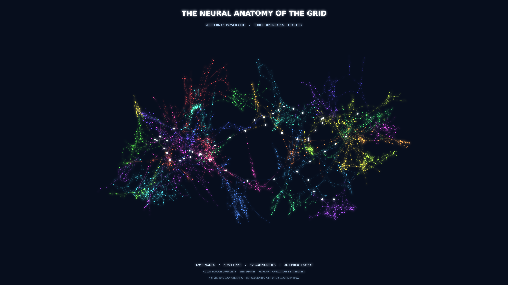

# The Neural Anatomy of the Grid

**A cinematic, data-driven 3D visualization of the Western United States power-grid network.**



**[Explore the interactive 3D visualization](NetworkViz_Interactive.html)** 
You can choose 1.(download the HTML and open it in a browser; GitHub does not render the interactive Plotly chart in its file preview).
Or 2. https://wanxiangzhiji.github.io/GridNetworVisualization/NetworkViz_Interactive.html?utm_source=chatgpt.com

## At a glance

| Network | Result |
|:--|--:|
| Nodes | 4,941 |
| Undirected links | 6,594 |
| Louvain communities | 42 |
| Modularity | 0.9359 |
| Visualization | 3D spring layout + cinematic rendering |

## What this project shows

This work transforms the **historical Western US Power Grid** into a 3D network art visualization. The graph represents power stations/substations as **nodes** and physical line connectivity as **undirected, unweighted edges**. Its branching structure and modular groups are visible in three dimensions, making hidden network organization easier to appreciate.

### Visual encoding

| Visual feature | Network property |
|:--|:--|
| Node hue | Louvain community membership |
| Node size | Degree (number of immediate neighbors) |
| Pale/white highlights | Top ~1% of nodes by **approximate** betweenness centrality |
| 3D placement | Spring layout, initialized from a 2D spring layout |
| Glow | Post-processing applied to already drawn edges and nodes |

**Interpretation limits:** 3D placement is a *topological illustration*, not actual geographic position or altitude. Bright links and highlights do **not** depict electrical power flow, facility ratings, failure probabilities, or physical criticality. Betweenness was estimated from 300 sampled source nodes (seed 580).

## Technology

Python · NetworkX · NumPy · pandas · Matplotlib · SciPy · Plotly · Pillow

## Reproduce the image

The project includes **cached community/centrality attributes and 3D positions**, so you can recreate the submitted image without rerunning the computationally expensive layout algorithms.

1. Get the **Western US Power Grid (`inf-power`)** GML from the cited source: https://networkrepository.com/inf_power.php . A GML copy of the matching classical network may also be available via [Netzschleuder](https://networks.skewed.de/net/power). Check the downloaded file matches **4,941 nodes and 6,594 edges**.
2. Save the GML at `network.gml/network.gml` (create the directory if necessary). The dataset itself is **not redistributed here** pending confirmation of the original provider's redistribution terms.
3. In the repository root, create a Python 3.11+ environment and run:

   ```bash
   python -m pip install -r requirements.txt
   python Step6_6_Cinematic_3D.py
   ```

4. Outputs are written to `Step6_6_Output/`, including `Step6_6_Cinematic_3D_Poster.png` and `Step6_6_Cinematic_3D_Interactive.html`.

### Recompute the analytical pipeline (optional)

```bash
python Step4_Louvain_Communities.py
python Step5_Centrality_Analysis.py
python Step6_4_3D_Spring.py
python Step6_6_Cinematic_3D.py
```

Running earlier steps may replace cached files and produce a different spring layout or community ordering with different versions/settings. To reproduce the *published* artwork, use the supplied caches and run only `Step6_6_Cinematic_3D.py`.

## Repository contents

| File | Description |
|:--|:--|
| `NetworkViz.png` | Final 3840 × 2160 cinematic poster |
| `NetworkViz_Interactive.html` | Self-contained interactive Plotly 3D graphic |
| `NetworkViz_Description.txt` | Short description of the work |
| `Step4_Louvain_Communities.py` | Community detection and 2D layout script |
| `Step5_Centrality_Analysis.py` | Centrality calculations |
| `Step6_4_3D_Spring.py` | 3D spring layout |
| `Step6_6_Cinematic_3D.py` | Final figure renderer and interactive chart generator |
| `Step4_Spring_Positions.csv` | Cached 2D layout |
| `Step5_Node_Centrality.csv` | Cached node metrics |
| `Step6_4_Positions_3D_spring.csv` | Cached 3D layout |
| `network.gml/` | User-provided downloaded source file location (original GML omitted) |

## Data and citations

- Watts, D. J., & Strogatz, S. H. (1998). *Collective dynamics of ‘small-world’ networks*. Nature, 393, 440–442. https://doi.org/10.1038/30918
- Rossi, R. A., & Ahmed, N. K. (2015). *The Network Data Repository with Interactive Graph Analytics and Visualization*. AAAI. https://networkrepository.com/
- Dataset page: https://networkrepository.com/inf_power.php

This project is a visualization of a **historical research dataset**, not an up-to-date grid model.

## AI assistance

ChatGPT was used to assist with Python scripting, troubleshooting, visual design, and preparation of explanatory documentation. The network connectivity and metrics were derived programmatically from the cited network dataset, while glow is a rendering effect.

## License note

No software license is claimed for this repository yet. Before adding a reuse license or including the source dataset, check the relevant rights and distribution conditions. The citations above do not themselves grant permission to redistribute the source data.
